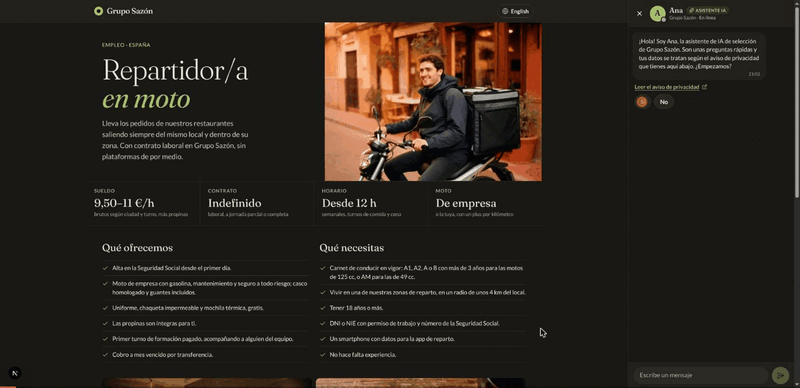
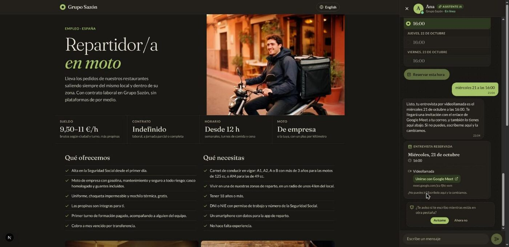
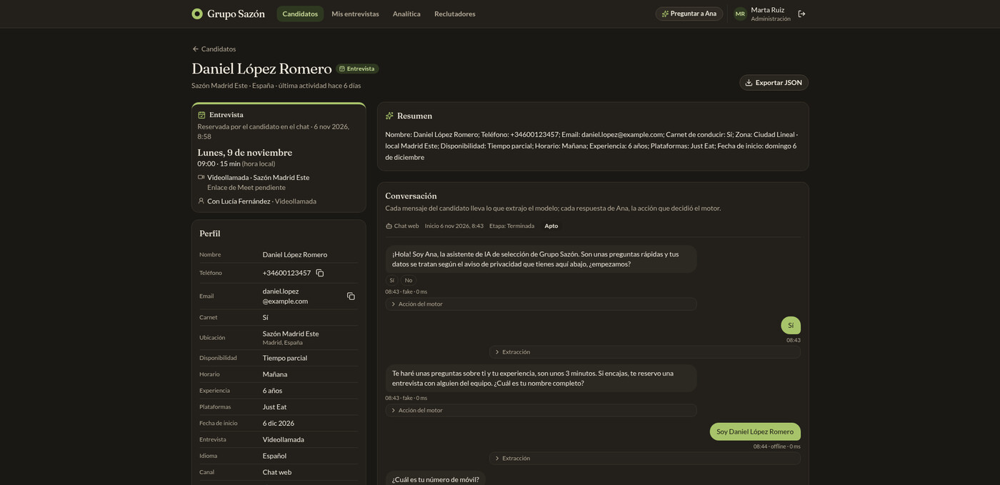
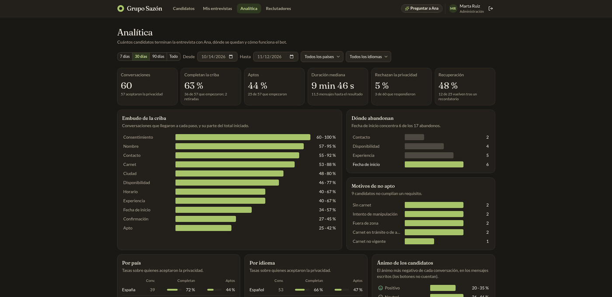

# Sazón Screener

Ana screens delivery-driver applicants for Grupo Sazón, a fictional restaurant chain with kitchens in Spain and Mexico. A candidate opens the chat from the job posting, in a panel beside the ad, or talks to her by voice, in Spanish, English or a mix of both. In about three minutes she collects what recruiters need to know, closes kindly when someone doesn't qualify, and books an interview when they do: by video with one of the central recruiters, on their calendar with a Google Meet link, or in person with the location's manager, invited from an organizer account and never on a recruiter's calendar. Recruiters get a dashboard with every candidate, a summary of each conversation, analytics, and an assistant that answers questions about the pipeline.



| The chat beside the posting, after booking | A candidate in the recruiter dashboard | Analytics |
|---|---|---|
|  |  |  |

## Setup

You need [uv](https://docs.astral.sh/uv/) and Node 26 (`mise install` sets up both Python 3.13 and Node). Then:

```sh
git clone https://github.com/IpastorSan/hr-screener-ai-agent.git
cd hr-screener-ai-agent
make demo
```

`make demo` installs the dependencies and downloads the FAQ's embedding model, `sentence-transformers/paraphrase-multilingual-MiniLM-L12-v2` through fastembed (about 240 MB, once). It then creates `backend/demo.db` and seeds it with six recruiters and 60 candidate conversations, and starts the API on :8000 and the web on :3000:

- Candidate chat: http://localhost:3000/apply
- Recruiter dashboard: http://localhost:3000/recruiters. The demo accounts and their passwords are in `backend/src/sazon/agents/riders/data/recruiters.json`.

With no `OPENROUTER_API_KEY` in `backend/.env`, the demo runs offline: a keyword extractor and template replies, no model calls. Add a key (copy `backend/.env.example`) and the same command uses the real models. The demo also speeds up the nudges to a quiet candidate so you can watch them: normally Ana writes 3 minutes after the candidate goes quiet and again 15 minutes later; in `make demo` that is 9 seconds and 45 seconds. Every run resets the demo database. `DEMO_API_PORT` and `DEMO_WEB_PORT` change the ports.

For development:

```sh
cp backend/.env.example backend/.env    # OPENROUTER_API_KEY and the rest
make dev-api                            # API on :8000, reloads on change
make dev-web                            # web on :3000
make check                              # ruff, pyright, pytest, then the web's lint, tsc, tests and build
cd backend && uv run sazon chat         # talk to Ana in the terminal (--fake for no model)
cd backend && uv run sazon seed --reset # demo data in the dev database
```

### Requirements beyond the demo

The demo runs without these; the full product needs them.

- **An OpenRouter API key** for the real models (`OPENROUTER_API_KEY` in `backend/.env`).
- **An ElevenLabs agent and a public URL for the API** for voice, since ElevenLabs calls the API from the internet.
- **A Google OAuth client** for Google sign-in and Google Calendar (video interviews, free/busy, invites).

[deploy/README.md](deploy/README.md) sets up the last two and covers the production stack (one VM, Caddy, CI on push to `main`, nightly integrity-checked backups to Cloud Storage in Madrid kept 30 days, rollback). `make stack-up` runs that stack locally on http://localhost:8080, and `make obs-up` adds Langfuse, Prometheus, Loki and Grafana.

## Architecture



The diagram's source is [docs/architecture.mmd](docs/architecture.mmd), with the command to render it again.

Each candidate message runs the same loop, whatever the channel:

1. **Extract.** One model call turns the message into a typed `TurnExtraction`: intent, every field mentioned with a confidence, the grammatical language, explicit language requests, sentiment, any question, and a slot or mode choice.
2. **Decide.** The engine, plain Python with no model and no I/O, validates each value and picks the next action. It may ask, re-ask, clarify, read a value back, answer from the FAQ, disqualify, offer interview times, or book one. Licence and service area are gates. Required data (full name with surname(s), licence, city, and a phone or email) still unresolved after the re-asks closes the application, and the candidate can start again. Phone and email find an open application to resume.
3. **Respond.** A second model call phrases that action in the candidate's language and register (tú in Spain, usted in Mexico). A guard checks the reply before it is sent: length, one question and it comes last, the register, no promise of future contact, no mixed languages. A reply that fails is retried once, then replaced by the action's template. The widget under the message (buttons, the slot picker, the summary card) comes from the engine, never from the model.

When the conversation ends, a third call writes the recruiter summary. Every turn is stored with its extraction, its action, latency and cost.

Where things live:

| Path | What |
|---|---|
| `backend/src/sazon/engine/` | The state machine (its statechart: [docs/engine/states.mmd](docs/engine/states.mmd)), validators, service areas, language choice. Imports no LLM SDK. |
| `backend/src/sazon/agents/` | The screening agents, one directory each: its spec (`agent.yaml`: the fields, their types, gates and rules), its text packs and labels (`texts/`), and the Python hooks its spec names. Two ship: `riders`, the default and the one this README describes, and `teachers`, which screens teachers for Colegio Albéniz, a fictional bilingual school in Madrid, with the teaching degree or master's and the sex-offender registry certificate as gates. `SAZON_AGENT` picks one; `sazon new-agent <name>` writes a new one to fill in, with a journey per field type and gate. |
| `backend/src/sazon/llm/` | Pydantic AI roles over OpenRouter, the prompts, the reply guard, the templates, `OfflineLLM` and `FakeLLM`. |
| `backend/src/sazon/service.py` | Runs a turn: storage, dedupe, retrieval, scheduling, summaries, abuse and injection handling. |
| `backend/src/sazon/scheduling/`, `calendar/` | Open times: video from recruiters' working hours and Google Calendar free/busy, in person from each location's interview hours and daily capacity. Booking under locks. Push sync when a recruiter moves or deletes an event, or a manager declines an in-person invite and the candidate is offered new times. |
| `backend/src/sazon/rag/` | The FAQ and company documents, embedded locally with fastembed (`paraphrase-multilingual-MiniLM-L12-v2`), so no candidate question leaves the machine for embedding. |
| `backend/src/sazon/channels/`, `api/voice.py` | The OpenAI-compatible endpoint ElevenLabs calls as its custom LLM, streaming the engine's reply. |
| `backend/src/sazon/recruiter_assistant.py` | "Preguntar a Ana": a Pydantic AI agent with read-only tools. A number or candidate in its answer that no tool returned is dropped. |
| `web/` | Next.js and shadcn: careers pages, the candidate chat and voice page, the recruiter dashboard (candidates, interviews, team, analytics). |
| `evals/` | The model benchmark (235 labelled extraction cases and 41 reply cases), the end-to-end personas and the scripted candidate journeys. |
| `docs/` | The full screening rules, sample conversations, deployment and operations. |

### The recruiter dashboard

Recruiters sign in with Google or a password at `/recruiters`, and see only the candidates at their own locations plus those whose video interview is theirs; a candidate with no location (closed before the city question, or out of area) counts at the location of the posting they applied from, or, when it named none, at every location of their country. Admins see everyone. The candidate list filters by screening result, location, country, availability, schedule, review status, assigned recruiter, talent pool and quality flags, and searches by name, email or phone. A candidate's page shows their answers, the conversation summary, flags, the booking and the full transcript, with the extraction and the engine's action behind every turn. There the recruiter sets the review status (new, contacted, hired, rejected) and can export the candidate as JSON.

"Mis entrevistas" lists a recruiter's upcoming interviews: the video ones on their own calendar, and the in-person ones at their locations, which they can see but not move. Analytics shows completion, qualification, the screening funnel, where candidates drop off, disqualification reasons, mood, quality signals, model cost and latency, and the questions Ana couldn't answer, grouped so the FAQ can grow where candidates need it. Admins also get the team page, where they add, edit and deactivate recruiters; erasing a candidate (`DELETE /api/candidates/{id}`, or `sazon erase`) is admin-only too.

"Preguntar a Ana" is a recruiter assistant beside all of this: a Pydantic AI agent on the same OpenRouter client, with zero data retention and `data_collection: deny`, on `LLM_ASSISTANT` (the responder's model when empty). It has three read-only tools: search candidates, get one candidate, and the pipeline metrics, over the candidates at the recruiter's own locations (every location for an admin). One question gets at most 6 model requests and 8 tool calls. It answers with a short text plus typed insights (a stat, a candidate table, a bar chart or a funnel) that the dashboard draws with its own components. Nothing it writes is trusted.

- Candidate rows are filled from the tool results; the model only names candidates by id.
- A number in its answer that no tool returned this turn is dropped.
- Candidate text reaches it as quoted data, with an instruction never to follow it.
- Its database session refuses to write.

### Features beyond the core flow

- Voice ([deploy/README.md#voice](deploy/README.md#voice)). The call page keeps its own conversation per country and language, and "Empezar de nuevo" in its header ends the call and starts a fresh application.
- Spanish, English and Spanglish, with the reply language decided every turn.
- FAQ answers from retrieval. The questions Ana can't answer appear under "Preguntas sin respuesta" on the analytics page, grouped by meaning with the same local embedding model, the most asked first, with an example candidate each and a CSV export (`GET /api/analytics/faq-misses`, `/api/analytics/faq-misses.csv`).
- Interview booking on Google Calendar, by video with a recruiter or in person with the location's manager, and moving or cancelling it by chat. A candidate who cancels is asked once ("¿La cancelo o prefieres otra hora?"), and a cancelled interview marks the application withdrawn.
- Shorter replies and an offer to pause when a candidate is frustrated.
- Nudges for idle candidates.
- Abuse and prompt injections close the application.
- Analytics ([web/src/app/recruiters/analytics](web/src/app/recruiters/analytics)).

## Decisions

**The flow is code; the model extracts and phrases.** Stages, gates, validation and branching live in a deterministic state machine. Chat and voice share it and can't drift apart. The disqualification rules can be read and unit-tested, and swapping a model is a config change. The cost is rigidity: an unusual conversation gets a re-ask where a free agent might improvise. We accept that, because a screening has to apply the same rules to everyone. A prompt injection can make the model say something odd. It can't set a field, because only validators set fields, and once the extractor flags an injection the application closes.

**Pydantic AI for the model calls, and the flow in our own code.** Each role needs a typed result: the extractor returns a `TurnExtraction`, the assistant returns insights. Pydantic AI validates that output against the Pydantic model and asks the model again when it doesn't fit. It switches providers behind one interface, and it's a light library: it makes the call and returns the result, so the flow and the error handling stay in our code. LangGraph didn't fit from the start. It brings its own graph and runtime for orchestration, and the screening flow is a deterministic state machine that we wanted to own and test directly, as plain Python with no model in it. A timeout, a refusal or an output that never validates is caught in our own LLM layer, which falls back to a re-ask or a template, and each case has a test.

**OpenRouter, with every call at zero data retention and `data_collection: deny`.** One client reaches every provider, so the model choice could be measured rather than assumed. ZDR is enforced on every request and has no off switch. The base URL is configurable, so EU in-region routing (`eu.openrouter.ai`) is one setting away on a business plan.

**Models chosen by measurement.** 12 models ran through the production LLM layer on labelled extraction cases and 41 reply cases ([evals/results/model_selection.md](evals/results/model_selection.md)). The default extractor has since run on the 217 extraction cases the file held on 21 October: it got every field right on 96% of the 181 ordinary messages and passed 34 of the 36 phrasings the engine relies on it to normalize. The file now holds 235, with 18 cases for follow-up and multi-part questions. The defaults:

| Role | Model | Why |
|---|---|---|
| Extractor | `google/gemini-3.5-flash-lite@minimal` | Passed all 36 engine-contract cases in the 12-model run (Haiku 5.5 passed 34), about 1.1 s a message |
| Responder | `anthropic/claude-haiku-5.5` | 93% of replies pass the reply checks (the rest go out as the template), 0.72 s to first token, which voice needs |
| Summarizer | `anthropic/claude-haiku-5.5` | One call per candidate |

That is about **$19 per 1,000 screenings** at 12 extract and 12 respond calls each, with the current prompts. The latest end-to-end run measured $0.0144 per conversation, summary included. A Sonnet 5.5 responder reads better to the judge and costs about $71 per 1,000 screenings.

**Deterministic widgets, after trying generative UI.** The first plan had the model write OpenUI markup, so a reply could render its own buttons and cards. A spike showed it worked from Python through OpenRouter. It also showed the cost. Without the vendor's paid gateway a malformed answer rendered as a silent blank. The format instructions added 4.6 KB to every call. And the dependency was months old. The engine now attaches a typed `ui` field (buttons, slots, the summary card) to each action, and the model writes only text. The recruiter assistant returns typed insights that the dashboard renders with its own components.

**Voice through ElevenLabs with our own engine as the custom LLM.** ElevenLabs handles speech-to-text, turn-taking and the voice. It calls `/v1/chat/completions` on our API, which runs the same engine with `channel=voice` and streams the reply sentence by sentence. The voice prompt caps replies at about 15 words and reads at most two options aloud. ElevenLabs' EU residency and zero retention are enterprise features, so on a normal plan audio is processed in the US. The agent asks for no recording and sets retention to zero days. ElevenLabs may ask for a reply on the early transcript and again on the final one; both requests are answered from one turn.

**Nudges in the browser.** The chat nudges a quiet candidate 3 minutes after their last message and again 15 minutes after that, with a browser notification when the tab is hidden. A conversation idle for 72 hours counts as abandoned when it is read. That needs no background job in stage 1. The cost: a closed tab can't be reached.

**SQLite for the demo and stage 1, Postgres for stage 2.** SQLite on one VM with nightly integrity-checked backups and a restore drilled on a real backup covers a few hundred screenings a day. The models, the Alembic migrations (batch mode) and the booking locks are written to run on Postgres too; the move itself is not built.

**Self-hosted observability.** Langfuse traces every model call with personally identifiable information (PII) masked, Prometheus and Loki take metrics and logs, and Grafana alerts.

## Testing and evals

`make check` runs about 3,900 Python tests (3,120 for the backend, 775 for the eval harness) and the web's checks. The engine tests use `FakeLLM`, so they need no network.

Before a release, `make mutation-audit` plants 86 deliberate bugs one at a time, in injection rejects, the licence and area gates, booking, auth, PII in logs and voice turns, and checks that the tests catch every one. It takes about 2 minutes, so it isn't run on every change.

The end-to-end evals put 28 simulated candidates through the real service: happy paths in Spain and Mexico, Spanglish, a switch to English, vague answers, no licence, out of area, injections in hidden Unicode, Morse and runes, abuse, frustration, a returning candidate, no free interviewer and an implausible experience claim. Each conversation is scored by deterministic checks (outcome, fields, language turn by turn, length, one question, register, no promises, AI disclosure, real slots, flags), and pass or fail rests on those alone. An LLM judge (Opus 5.5) also reads each whole conversation and scores tone, naturalness, empathy, staying in role and brevity, which no rule can check. Its scores are a guide, not a gate: in a blind check of 20 reply pairs, a person agreed with the benchmark's judge on 9, and the conversation judge has not been checked against a person. In the latest run 27 of the 28 ended where they should and 25 passed every check; the results are in [evals/results/e2e.md](evals/results/e2e.md).

```sh
uv run --project backend python -m evals.e2e --offline                        # no model, proves the harness
uv run --project backend python -m evals.e2e --combo A --personas all         # about $0.94 a run
uv run --project backend python -m evals.model_selection --stage extraction --models <ids> --dry-run
```

The candidate journeys (`make journeys`) script 257 multi-session chats (233 for the riders, 24 for the teachers) with an expectation on every step; the QA sweep that wrote most of them, and what it found, is in [evals/results/qa-sweep-2026-10-21.md](evals/results/qa-sweep-2026-10-21.md).

## Caveats

- **The FAQ is invented.** The questions, answers, pay ranges and policies in `backend/src/sazon/rag/` were written for the demo. Retrieval and the unknown-question log work the same with a real company's FAQ in their place.
- **The locations and their managers are invented too.** The kitchens, their addresses, interview hours and managers in `backend/src/sazon/agents/riders/data/service_areas.json` are fictional, and the managers' emails are at the `gruposazon.example` domain.
- **Frustration is measured on 13 messages.** The shorter replies and the pause offer depend on the extractor labelling a message `frustrated`. On the latest run the default extractor labelled all 13 frustrated cases correctly, 5 insults and 8 polite complaints ("Seriously, how many more questions? I just want to apply."), and no calm message as frustrated.
- **A phone number or email is not proof of identity.** A returning candidate is recognised by the phone or email they give, and nothing checks that it is theirs. Anyone who knows a candidate's phone or email can open a new chat, see the day, time and place of their interview, and move it. I chose not to build verification yet.

## Improvements

- **Connect an applicant tracking system (ATS), which also tells Ana where to hire.** Ana would push each qualified candidate to the ATS when the interview is booked, and the ATS would send status changes, such as a hire, back to the dashboard. The same connection would read each location's open requisition and its remaining openings: a location with none left stops booking interviews, offers the talent pool, and its posting closes. Today nothing tracks openings, so every qualified candidate gets an interview and a location that needs one rider could fill its calendar with nineteen. Without an ATS, recruiters would set a headcount per location in the dashboard instead, counted down by hires (the "hired" review status already records them). None of it is built.
- **Experience by hours.** A year of weekend deliveries counts the same as a year full time, because the screening doesn't ask hours per week. Asking would let recruiters compare full-time-equivalent years.
- **Better scheduling.** The booking rests on assumptions about how a chain like Grupo Sazón interviews. Video interviews are with the central recruiters, on their Google Calendars. In-person interviews are with each location's manager, whose email is made up. One organizer account (`ONSITE_ORGANIZER_EMAIL`) sends every in-person invite, and each location has fixed interview hours and a fixed capacity per slot and per day. A real deployment needs the managers' own calendars, so their meetings, shifts and days off block times, and hours each manager sets for themselves.
- **Verify a returning candidate before showing their booking.** Before Ana shows or changes an interview, she would send a one-time code or a magic link to the phone or email on file. A simpler option is to make the private link to the original chat (`/apply?c=…`, which already exists) the only way to change a booking, and include it in the confirmation and the calendar invite.
- **WhatsApp, designed but not built.** It is one of the main channels companies use to screen candidates, and the engine knows nothing about the web, so it is the natural next channel. An adapter would turn each widget into WhatsApp's interactive messages: reply buttons for up to three options, a list message for up to ten (a city's locations, the interview times). WhatsApp allows free-form messages only within 24 hours of the candidate's last one, so a nudge after a day of silence has to be an approved template. The sender's phone number is verified by WhatsApp, which helps with identity: a returning candidate writing from the number on file is that number's owner, unlike a phone typed into the web chat. Most of the cost is outside the code: a Meta business account and a registered number, and approval for every template.
- **English replies thrown away.** Ana doesn't switch to English at once: she waits for two turns written in English, or an explicit request. Once she does, the guard against mixed languages sometimes rejects an English reply because it quotes a Spanish place name, and the candidate gets the plainer template instead.
