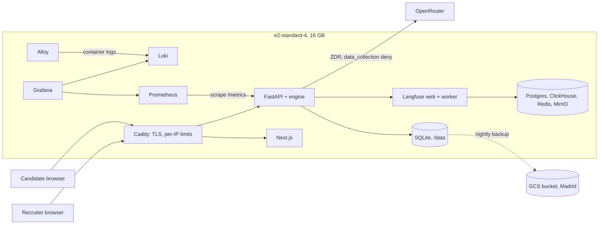

# Deployment and operations

The screener runs on one VM, sized for about 1,400 screenings a day. At that volume it costs about $27 a day in model calls and $135 a month in infrastructure. Everything runs in Google Cloud `europe-southwest1` (Madrid). Scaling past one VM is not built.

## The VM

| Part | What runs |
|---|---|
| Compute | 1 Compute Engine VM, Docker Compose |
| Entry | Caddy, automatic TLS |
| Database | SQLite in `/opt/sazon/data` on the VM's disk |
| Images | Built per commit SHA |
| Secrets | GitHub `production` environment secrets, written into `.env` (mode 600) at each deploy |
| Infrastructure | One VM created by hand, documented |
| Fits | Up to about 30 concurrent conversations; a VM restart is downtime |

| Piece | Choice |
|---|---|
| Release | GitHub Actions on push to `main`: `make check` (backend and web), then images tagged with the commit SHA, pushed to Artifact Registry |
| Deploy | Pull the new SHA, `docker compose up -d` (the API runs `alembic upgrade head` on startup), poll `/readyz` for 60 s, roll back to the previous SHA if it never passes |
| Health | `/healthz`: the process answers. `/readyz`: database reachable, migrations at head, FAQ index loaded. OpenRouter is left out, since the chat degrades to templates without it and a provider blip must not roll a deploy back; `/readyz?deep=1` adds it |
| Backups | Nightly SQLite online backup with `PRAGMA integrity_check`, gzipped to a GCS bucket in Madrid, 30-day lifecycle; the newest 14 also stay on the VM |
| Restore test | A drill on the local stack (`deploy/test-restore.sh`): back up, delete the database, restore, compare the row counts of every table and pass `/readyz`. A backup older than 26 hours alerts |
| Spend cap | `MAX_DAILY_LLM_USD`, for example $60 a day (2.2 times the forecast). At the cap new chats get a come-back-later message and open ones finish on the keyword extractor and template replies; an alert fires at 80% |
| Rate limits | Per IP: 20 new conversations an hour, 60 messages a minute (`RATE_LIMIT_CONVERSATIONS_PER_HOUR`, `RATE_LIMIT_MESSAGES_PER_MINUTE`). Per conversation: one message in flight (an in-process lock per conversation), 2,000 characters a message |

The VM is an e2-standard-4 (16 GB) because self-hosted Langfuse v4 brings Postgres, ClickHouse, Redis and MinIO with it. Measured on the local stack, the whole observability stack idles at about 3.5 GB, and its memory limits add up to about 10 GB. Each container has a limit so ClickHouse can't starve the API.

ElevenLabs processes call audio in the United States unless the account is on the Enterprise EU residency environment (`ELEVENLABS_API_URL`).

## One turn, one transaction

A candidate turn reads the database once and writes it once (`Unit` in `backend/src/sazon/storage/repo.py`). The read loads the conversation with its candidate, then its turns: 2 statements. Everything the turn changes is held in memory and written in one transaction at the end. A typical answer costs 6 statements and 1 commit, down from 13 statements in 4 commits; a phone or email adds the 2 duplicate-check lookups. The only writes that commit on their own are the scheduling ones (a booking, a cancellation, new slots), which also talk to the calendar.

Every database call of a turn runs in a worker thread (`asyncio.to_thread`), never on the event loop, so a slow query delays only its own conversation. The tests fail any turn that queries on the loop. The async SQLAlchemy engine was the alternative. It would need `aiosqlite` and `asyncpg`, and an async rewrite of the scheduling and calendar code, which is synchronous and already runs in threads. A thread hop costs microseconds against a turn's 2 s of model calls.

The model calls run between the read and the write, and the two databases hold different things while they wait:
- **SQLite** (stage 1) ends the read transaction straight away and returns the connection, so nothing is held during the model calls. The write transaction lasts only as long as the commit, so turns of different conversations don't block each other's writes. One turn at a time per conversation is the in-process lock's job.
- **Postgres** (stage 2) keeps one transaction for the whole turn. It opens with `SET LOCAL lock_timeout = '30s'` and `pg_advisory_xact_lock(hashtextextended(conversation_id, 0))`, sits idle through the model calls (reads take no row locks), and the commit or rollback releases the lock. A turn of the same conversation in another process waits for it, then reads what it stored. Each open turn holds a pooled connection, and a booking needs a second one, so a process keeps at most the pool less 3 turns open (`Repo.max_units`). Without that cap, turns holding every connection would wait on each other's bookings until the pool timed out. Pool and PgBouncer sizing are part of stage 2.

A turn that fails stores nothing: a model error, a crash, a failed write, or a client that disconnects mid-stream (which cancels the turn). The candidate's message is not in the transcript and gets no reply, or only the part that had streamed, so they send it again. Writing the candidate's turn before the model calls, as before, left a message with no reply and a state that had not moved. Two things survive a failed turn. Its model spend is not stored, so the daily cap undercounts it. A booking committed before the failure stays. When the candidate picks a time again, the new booking replaces it, or is the same booking if they pick the same time.

## Nudges

Nudges run in the candidate's browser, once the privacy notice is accepted (the API refuses one before). After 3 minutes of silence, and again after 15 more, the open tab asks the API for a nudge; when the tab is hidden it also shows a browser notification, if the candidate allowed one, outside 22:00 to 09:00 local time. A conversation idle for more than 72 hours counts as abandoned, computed when it is read. No server job runs for nudges.

The cost of that choice: a candidate who closed the tab can't be reached. Web Push, email or a messaging channel would close the gap; see the last section.

## Data, residency and retention

| Data | Where | Kept |
|---|---|---|
| Applications, turns, bookings | SQLite on the VM, Madrid | 12 months from the candidate's last message, as the privacy notice says |
| Backups | GCS, Madrid | 30 days, so a deletion leaves the backups within a month |
| LLM traces | Langfuse, Madrid, PII masked | 30 days (a daily job: open-source Langfuse has no retention setting) |
| Logs | Loki, Madrid; ids only, no message text | 30 days |
| Metrics | Prometheus, 15 days | No personal data |
| FAQ embeddings | Computed on the instance (fastembed, ONNX), also to group the unanswered questions on the analytics page | Nothing leaves the machine |

Every LLM call goes to OpenRouter with `provider: {zdr: true, data_collection: "deny"}`; the model per role is configuration. Messages may be processed in the US for as long as a reply takes, under standard contractual clauses, which is what the privacy notice tells candidates. The production option is OpenRouter's EU endpoint (`https://eu.openrouter.ai/api/v1`, Business plan), which fails closed when no EU endpoint serves a model; Claude Haiku 5.5 and the Gemini 3.x Flash family were listed with EU ZDR endpoints in October 2026. Either way OpenRouter keeps account, billing and abuse-monitoring metadata in the US. Mexico's LFPDPPP is covered by the same controls. A daily systemd timer on the VM runs `sazon purge` to delete expired applications (with their calendar events).

## Observability

Self-hosted only. Candidate messages hold names, phone numbers and where people live; hosted tracing such as Logfire or LangSmith would put a copy in a third party's store, which undoes the point of zero retention at the model provider.

| Tool | What it holds |
|---|---|
| Langfuse (v4) | One trace per candidate message over OpenTelemetry, session = conversation: sanitize, extract, engine step, fill action, respond and persist spans, with Pydantic AI's model spans (messages, model, tokens, cost from OpenRouter, latency, fallback) and the prompt version (hash of the prompt files). Names, phones and emails are masked before export |
| Prometheus | `/metrics`, internal only: `sazon_llm_calls_total{role,model}`, `sazon_llm_latency_seconds{role,model}`, `sazon_llm_fallback_total{role}`, `sazon_llm_cost_usd_total{role,model}` (model calls only; fixed replies count in `sazon_fixed_replies_total{role}`), `sazon_turns_total{role}`, `sazon_conversations_started_total{country,channel}`, `sazon_conversation_outcomes_total{outcome}`, `sazon_quality_flags_total{flag}`, nudges served and recovered, OpenRouter errors by status, spend today and the cap, Google Calendar notifications, reconciliations and push-channel health. Full list in `deploy/README.md` |
| Loki | Structured JSON logs with conversation and trace ids, shipped by Grafana Alloy |
| Grafana | The dashboard's analytics (`fallback_rate`, `p95_latency_ms`, `cost_per_conversation_usd`, flags, nudge `recovery_rate`) as time series, plus the alerts below |

| Alert | Condition | Severity |
|---|---|---|
| Fallback rate | Over 5% of model calls for 15 minutes | Page |
| Responder latency | p95 over 4 s for 10 minutes | Page |
| Daily spend | Over 80% of the cap | Warn |
| OpenRouter 402 or 403 | Any (credits, or the key's own limit, which OpenRouter answers with 403) | Page |
| OpenRouter 429 | Over 2% of calls for 10 minutes | Warn |
| Injection spike | `injection_suspected` flags over 3 times the 7-day hourly baseline | Warn |
| `/readyz` | Failing for 2 minutes (blackbox probe) | Page |
| Backups | Newest local backup older than 26 hours | Page |
| Calendar push channels | A connected Google Calendar without a push channel, or with one under 24 hours from expiry, for 30 minutes (the daily renewal failed) | Warn |

## Security

| Layer | Control |
|---|---|
| Edge | TLS everywhere, terminated by Caddy |
| Limits | The per-IP and per-conversation limits above, kept loose per IP because Mexican mobile carriers put many users behind one address |
| Injection | Fields are written only by validators and outcomes only by the engine. Input is NFKC-normalized and stripped of zero-width, bidi and tag characters; candidate text reaches the model as quoted data; output is schema-checked; the dashboard renders candidate text as plain text; the recruiter assistant has read-only tools |
| PII | Masked in traces, absent from logs, never echoed in error responses; the database disk is encrypted at rest by Google |
| Secrets | OpenRouter key, session secret, Google client secret and token encryption key as GitHub `production` environment secrets, written into `.env` (mode 600) at deploy; Langfuse and Grafana keys in `observability.env` on the VM (mode 600) |

## Compliance

| Rule | What it requires | How the screener meets it |
|---|---|---|
| AI Act Art. 50, applies since 2 Aug 2026 | Tell people they are talking to an AI | "AI assistant" label in the chat header and in Ana's first message; same in Mexico |
| AI Act Annex III point 4(a): filtering job applications is high-risk | Obligations apply from 2 Dec 2027 (Regulation (EU) 2026/1744, the Digital Omnibus, published in the Official Journal on 24 July 2026) | Below |
| Human oversight (Art. 14, 26) | People decide, with the means to override | Recruiters make every hiring decision. The engine closes an application on its own in these cases only: no valid licence, a city outside every service area (read back to the candidate first), required data still unresolved after the retries (name, licence, city, or neither a phone nor an email; the candidate can start again), and an attempt to manipulate the assistant (policy violation: a warning on the next application, none after three such closes on a phone or email). A second insult ends the conversation, and the candidate can opt out at any time. Each close says why, and every case stays visible in the dashboard with its reason |
| Logging (Art. 12, 26(6)) | Automatic logs, kept 6 months or more | Every turn is stored with text, extraction, engine action, model, latency, cost and fallback; kept 12 months |
| Data governance and accuracy (Art. 10, 15) | Representative test data, measured accuracy | 235 gold-labelled extraction cases across ES, MX, English and Spanglish; disqualification rate by country and language in the analytics breakdown |
| Before Dec 2027 | Risk management, technical documentation, conformity assessment (internal control), EU database registration | Open work |
| GDPR and LFPDPPP | Consent, minimisation, retention, rights | Consent before any data is stored; only the fields the screening needs are collected; 12-month retention (`sazon purge`); export per candidate (`/export`); erasure on request with `sazon erase --phone\|--email\|--candidate-id` or `DELETE /api/candidates/{id}` (admins only; other recruiters get 403), which deletes the candidate, conversations, turns, summaries, FAQ misses, review and bookings, frees the slot and logs `candidate_erased` with no personal data. Propagating the deletion to an ATS is not built |

**Consent in hiring.** The EDPB's Guidelines 05/2020 on consent (section 3.1.1, imbalance of power) warn that consent is rarely freely given where an employer holds power over the person. A candidate can leave the chat at no cost and the notice pairs consent with Art. 6(1)(b), steps taken at the candidate's request before a contract, so screening keeps a basis if consent is found not to be free; keeping an out-of-area candidate's data in the talent pool, which is optional, rests on consent alone. The notice also carries the Art. 22(3) GDPR safeguards (human intervention, a point of view, contesting the decision) for every automated closure, and the AI Act Art. 26(11) statement that a high-risk AI system is used in the screening.

## Capacity and cost at 1,400 screenings a day

| Input | Value | Source |
|---|---|---|
| Screenings | 1,429 a day, 43,300 a month | Sizing target |
| Model calls per screening | 12 extract + 12 respond + 1 summary | Benchmark assumption |
| Extract call | $0.00134, p50 1.11 s, p95 1.77 s (Gemini 3.5 Flash-Lite, minimal reasoning, 2026-10-21 prompts) | `evals/results/model_selection.md` |
| Respond call | $0.00023, first token p50 0.72 s, p95 1.04 s (Claude Haiku 5.5) | Same |
| Cost per 1,000 screenings | $18.90 for 12 extract and 12 respond calls, about $19; the latest end-to-end run measured $0.0144 a conversation (10.1 turns on average, summary included) | Same, and `evals/results/e2e.md` |
| Peak hour | 2.5 times the average hour: 150 screenings | Assumption |
| Screening length | 6 minutes, 12 candidate messages | Assumption |
| Burst | 5 times peak, when a job post goes out | Assumption |

| Result | Value |
|---|---|
| Model calls | 35,700 a day; 1 a second at peak, 5 a second in a burst |
| Concurrent conversations | 15 at peak, 75 in a burst |
| Time to first token of a reply | 1.8 s at p50; at most 2.8 s at p95 (sum of the two p95s) |
| LLM cost | $27 a day, $823 a month |
| Database growth | about 40 KB a screening, 57 MB a day, 21 GB at 12-month steady state (estimate) |
| Traces | 17,000 a day into Langfuse, with 36,000 model spans |

| Infrastructure, per month (on-demand list prices, Madrid, estimates) | Cost |
|---|---|
| Compute | $115 (e2-standard-4; the database and observability run in the VM) |
| Disks, buckets, IP, registry, secrets | $20 |
| **Total** | **$135** |
| **Per screening, with LLM** | **$0.022** |

## Rollout

| Phase | Scope | Exit criteria |
|---|---|---|
| Shadow | 2 weeks, 3 locations (1 in Spain, 2 in Mexico). Ana screens, recruiters still phone every applicant, Ana's outcome changes nothing | Ana and the recruiter agree on disqualification in 98% of cases; field accuracy against recruiter notes of 95% or more |
| One location | 4 weeks at the busiest location. Ana's outcome is live | Completion rate of 60% or more, fallback rate under 2%, interview show rate no worse than the phone screen, no complaint left unresolved |
| All | Waves of about 10 locations a week, Spain first, then Mexico | Same metrics per wave. A per-location flag reverts to the phone screen in one config change |

Recruiter feedback closes the loop. A hire, a rejection or a "field was wrong" note on an Ana-screened candidate becomes a labelled case in the eval set.

## What I'd do differently, and next

- **Reach closed tabs.** Web Push first (service worker, VAPID keys; it reaches Android browsers and installed web apps on iOS), then email. Either adds the first server-side scheduled job.
- **WhatsApp, as an idea.** The engine knows nothing about the web, so a channel adapter could map widgets to interactive messages (up to 3 reply buttons, or a list of up to 10 rows). Nudges after 24 hours of silence would need approved templates, because free-form messages are only allowed inside the 24-hour window. Meta's test number would cover testing before any real number is registered.
- **Eval regression gate in CI.** On any change to prompts or `sazon/llm/`, run the 235 extraction cases (about $0.31 with the default extractor) and fail on a drop of more than 1 point in field F1 or any engine-contract miss.
- **Human review queues in Langfuse.** Route flagged and fallback turns to an annotation queue; reviewed turns become eval cases.
- **Calibrate the judge.** A blind human check agreed with the model-selection pairwise judge on 9 of 20 reply pairs, and the e2e conversation judge has never been checked, so judge scores are indicative until the rubric is anchored with labelled examples.
